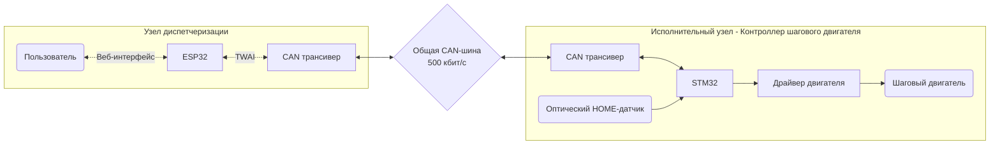
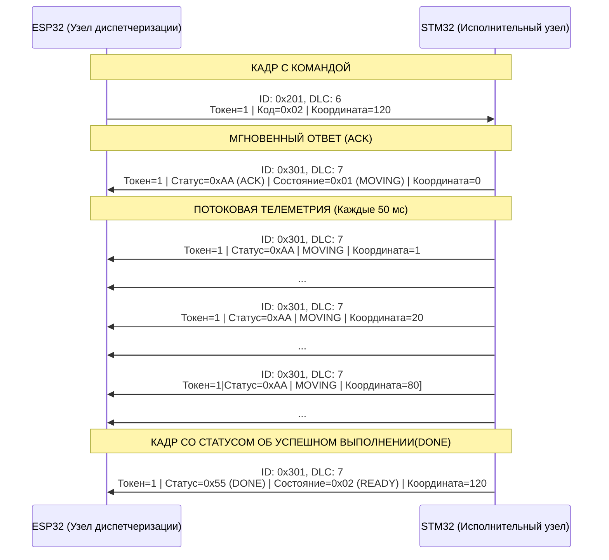

# Cистема управления устройствами по CAN. Версия 1.0

## Цель проекта

Разработать модульную систему управления несколькими независимыми исполнительными устройствами через общую CAN-шину.

Каждый исполнительный узел имеет собственный микроконтроллер и локально управляет подключенным оборудованием, обрабатывает данные с датчиков и отправляет текущее состояние. 

Через веб-интерфейс узла диспетчеризации оператор имеет возможность управлять любым исполнительным узлом и видеть его состояние в данный момент.

## Текущий объём реализации

Реализован прототип системы с узлом диспетчеризации на ESP32 и одним исполнительным узлом на STM32.

Узел диспетчеризации предоставляет веб-интерфейс для ввода команд оператором, передаёт их по CAN и получает ответ от исполнителя. 

Исполнительный узел - контроллер шагового двигателя. Принимает команду, управляет шаговым двигателем (перемещает каретку в расчетную координату в мм) и возвращает результат операции.

Протокол CAN обеспечивает возможность отправки команд и прием ответов между узлом диспетчеризации и несколькими исполнительными узлами

#### Архитектура системы

#### Видео работы установки

#### Аппаратная часть

| Компонент | Назначение |
|--|------|
| ESP32 NodeMCU | Wi-Fi, веб-интерфейс, работа с командами и ответами |
| CAN-трансивер WVCMCU-230 на базе SN65HVD230| Физический интерфейс CAN |
| USB-адаптер питания 5 В | Питание установки |
| | |
| STM32F103 Blue Pill | Исполнительный контроллер |
| Шаговый двигатель 28BYJ-48 | Перемещение каретки |
| Драйвер шагового двигателя на базе ULN2003 | Управление обмотками двигателя |
| Оптический датчик(фотопрерыватель) ITR9606 | Определение HOME |
| CAN-трансивер WVCMCU-230 на базе SN65HVD230 | Физический интерфейс CAN |
| USB-адаптер питания 5 В | Питание установки |

 

#### Схема подключения

#### Краткое описание принципа работы

1. **Запуск системы.** ESP32 инициализирует CAN, подключается к Wi-Fi и запускает веб-сервер. STM32 инициализирует CAN, таймеры и управление шаговым мотором.
2. **Подключение пользователя и калибровка.** Пользователь открывает веб-интерфейс ESP32 в браузере. Так как система не знает текущее положение каретки, оператор запускает процесс калибровки (определение точки 0 мм).
3. **Передача команды.** Оператор задает координату. ESP32 формирует CAN-сообщение с номером транзакции и координатой.
4. **Обработка команды на STM32.** Микроконтроллер проверяет команду на легитимность и запускает соответствующее действие.
5. **Возврат состояния.** При успешном выполнении команды STM32 отправляет по CAN подтверждение, текущий статус и рассчитанную координату.
6. **Обновление интерфейса.** ESP32 обрабатывает ответ и передаёт актуальные данные в браузер через WebSocket.
7. **Выполнение программы перемещений.** Если пользователь запустил последовательность координат, то после получения DONE для текущей команды ESP32 отправляет следующую.

#### Режимы работы

Для начала работы необходимо откалибровать систему. Для этого оператор нажимает кнопку `HOME`, после чего каретка начнет движение на пониженной скорости в сторону концевика(фотопрерывателя). При достижении концевика каретка остановится в позиции 0 мм.

1) **Ручной режим.** Оператор задает координату и нажимает кнопку `GOTO`. Мотор переместит каретку в расчетную координату
2) **Последовательность.** Оператор задает последовательность из координат. По нажатии кнопки `START SEQUENCE ` каретка перемещается по всем указанным координатам по очереди и останавливается в последней.

## Узел диспетчеризации на ESP32

#### Скриншот веб-интерфейса

#### Логика работы 

1. **Раздача HMI-интерфейса.**
   
   При вводе IP-адреса платы в браузере, ESP32 считывает файлы интерфейса (`index.html`, `style.css`, `app.js`) со своей внутренней флеш-памяти (`SPIFFS`) и отправляет их клиенту по протоколу HTTP. Браузер отрисовывает панель и открывает дуплексный канал WebSocket.

2. **Получение команды из браузера и парсинг.**

   Когда оператор задает команду через кнопки на сайте, браузер отправляет на ESP32 текстовую строку в формате JSON. WebSocket-сервер (`WebServer.cpp`) получает этот текст, парсит через библиотеку cJSON и передаёт в блок управления узлами `DeviceManager.cpp`.

3. **Отправка команды и прием ответов от узла по CAN.**
   
   Работа происходит по событийной модели. Если оператор задал последовательность перемещений (например: 20 -> 60 -> 15 мм), программа берет координату из массива, составляет кадр и отправляет в шину CAN. Как только исполнитель присылает ответ об успешном выполнении, отправляет следующую координату.

4. **Прием телеметрии и Heartbeat шины CAN.**

  Каждые 50 мс STM32 отправляет телеметрию по CAN. ESP32 принимает эти пакеты, переводит в JSON и отправляет по Wi-Fi, обновляя цифры в веб-интерфейсе.
  Если произойдет физический разрыв шины CAN, то ESP32 зафиксирует отсутствие этой циклической телеметрии и выведет на экран ошибку `LINK_ERROR`.

#### Программная структура

- `components/can_master/` — инициализация TWAI, передача команд и приём CAN-кадров.
- `components/device_manager/` — управление устройствами, обработка команд и автоматических последовательностей.
- `components/web_server/` — HTTP/WebSocket-интерфейс и обмен данными с браузером.
- `components/wifi_manager/` — подключение к Wi-Fi.
- `storage/` — HTML, CSS и JavaScript веб-интерфейса.
- `main/` — инициализация приложения.

Стек: C/С++, ESP32, VS Code, ESP-IDF 6.1

 

## Исполнительный узел - контроллер шагового двигателя на STM32

Архитектурные детали:

1. Аппаратный приём и фильтрация CAN 
   
   STM32 находится в режиме аппаратной фильтрации (CAN-фильтр настроен на прием команд от узла диспетчеризации). Принятый кадр обрабатывается через механизм прерывания. Обработчик прерывания расшифровывает и сохраняет токен поступившей команды, код операции и цель в миллиметрах.

2. Конечный автомат (FSM)

   В любой момент времени контроллер может находиться только в одном из следующих состояний:
     - `STARTUP` (инициализация),
     - `UNHOMED` (контроллер не откалиброван (положение 0 мм неизвестно), выполнение перемещений заблокировано),
     - `HOMING` (движение с пониженной скоростью в сторону концевика(фотопрерывателя), при его обнаружении происходит остановка и сохранение позиции 0 мм),
     - `READY` (ожидание команд, устройство откалибровано),
     - `MOVING` (выполнение перемещения каретки),
     - `FAULT` (авария).
   
    Перед любым действием модуль `motion.c` проверяет текущее состояние системы. 
    Если система находится в состоянии `UNHOMED`, любые команды перемещения от ESP32 отклоняются и возвращается отказ.
    Команда исполняется только после успешного прохождения калибровки нуля (`HOMING`) и перехода привода в статус готовности `READY`.

3. Алгоритм движения:

    a. **Получение цели.** STM32 получает целевую координату в миллиметрах и переводит её в количество шагов мотора. Коэффициент перевода(STEPS_PER_MM) у данной установки равен 44.15 шаг/мм)
   
   b. **Определение направления.** STM32 сравнивает текущую и целевую позиции: если цель впереди — вращает двигатель в одну сторону, если позади — в другую.

    c. **Трапециевидный профиль скорости.** Расчет скорости шагового мотора происходит в обработчике прерывания таймера TIM2.
       Период таймера TIM2 определяет, как часто вызывается прерывание, в котором выполняется очередной шаг двигателя.
       Поэтому чем меньше период между прерываниями, тем выше скорость двигателя.
        - Разгон: период таймера постепенно уменьшается — шаги выполняются чаще, двигатель ускоряется.
        - Постоянная скорость: период остаётся неизменным — двигатель вращается с постоянной скоростью.
        - Торможение: период постепенно увеличивается — шаги выполняются реже, двигатель замедляется.

   d. **Завершение**. Когда счётчик шагов достигает целевой позиции, STM32 прекращает движение, переходит в состояние `READY`.

    Для коротких перемещений разгон и торможение сокращаются или вообще не выполняются — мотор движется с начальной скоростью.

4. Отправка ответа и телеметрии
    При достижении целевой точки формируется пакет `DONE` (0x55) и отправляется по CAN узлу диспетчеризации.
    А также каждые 50 мс STM32 отправляет пакеты с текущим расчетным положением каретки. Это позволяет отображать в веб-интерфейсе изменение координаты в реальном времени и контролировать целостность шины CAN.

#### Программная структура

- `Core/Src/motion.c` — управление движением, позиционирование и состояния контроллера.
- `Core/Src/can_network.c` — фильтрация, приём команд и отправка ответов по CAN.
- `Core/Src/main.c` — инициализация периферии и основной цикл.
- `Core/Src/tim.c` и `Core/Src/gpio.c` — конфигурация таймеров и GPIO.

Стек: C, STM32F103C8T6, STM32CubeMX, VS Code, CMake, arm-none-eabi-gcc, Ninja, OpenOCD, Cortex-Debug

 

## CAN-протокол

Используется CAN со скоростью 500 кбит/с и стандартными 11-битными идентификаторами кадров. 

#### Адресация

Идентификаторы кадра формируются на основе базового адреса и идентификатора узла. Это позволяет адресовать команды и получать ответы между узлом диспетчеризации и несколькими исполнительными узлами.

| Назначение кадра | Формула | Исполнительный узел №1 | Будущий узел №2 
|---|---|---|----|
| Команда от диспетчера к исполнителю | `0x200 + Node_ID` | `0x201` | `0x202` |
| Ответ от исполнителя к диспетчеру | `0x300 + Node_ID` | `0x301` | `0x302` |

 

#### Структура кадра команды (Диспетчер -> Исполнитель). Команда содержит 6 байт данных

| Элемент кадра | Содержимое |
|---|---|
| CAN ID   | `0x200 + Node_ID`                                                        |
| Байт 0   | `Токен` (номер транзакции)                                                                 |
| Байт 1   | Код команды (`0x01` = HOME, `0x02` = GOTO, `0x03` = STOP)               |
| Байт 2-5 | Целевая координата в миллиметрах (32-bit `int32_t` в формате Big Endian) |

 

#### Структура кадра ответа (Исполнитель -> Диспетчер). Ответ содержит 7 байт данных

| Элемент кадра | Содержимое |
|---|---|
| CAN ID   | `0x300 + Node_ID` |
| Байт 0   | `Токен` (номер транзакции)   |
| Байт 1   | Статус транзакции (`0xAA` = ACK / Принято, `0xFF` = NACK / Отклонено, `0x55` = DONE / Успешно завершено) |
| Байт 2   | Состояние (`0x01` = MOVING, `0x02` = READY, `0x03` = FAULT, `0x04` = UNHOMED) |
| Байт 3-6 | Текущая расчётная координата каретки в мм (Big Endian) |

 

#### Пример

Команда: `Транзакция №5. Переместить каретку Узла 1 на координату 120 мм`

| Значение | Байт | Расшифровка | 
|---|---|---|
| 0x201 | CAN ID | База для адресации команд к исполнителю 0x200. У контроллера шагового двигателя ID=1
| 0x05 | Байт 0 | Токен (номер транзакции)
| 0x02 | Байт 1 | Код команды GOTO 
| 0x00 | Байт 2 | Координата: Старший байт 4 (Big Endian)
| 0x00 | Байт 3 | Координата: Байт 3
| 0x00 | Байт 4 | Координата: Байт 2
| 0x78 | Байт 5 | Координата: Младший байт 1 (0x78 = 120 мм)

 

Ответ: `Транзакция №5. Успешно выполнена. Текущее состояние READY. Расчетная позиция каретки 120 мм`

| Значение | Байт | Расшифровка | 
|---|---|---|
0x301 | CAN ID | База для адресации ответов это 0x300. У контроллера шагового двигателя ID=1
0x05 | Байт 0 | Токен (номер транзакции)
0x55 | Байт 1 | Статус транзакции DONE
0x02 | Байт 2 | Состояние READY 
0x00 | Байт 3 | Расчётная позиция: Старший байт 4 (Big Endian)
0x00 | Байт 4 | Расчётная позиция: Байт 3
0x00 | Байт 5 | Расчётная позиция: Байт 2
0x78 | Байт 6 | Расчётная позиция: Младший байт 1 (Каретка стоит в расчётной координате 120 мм)

 

#### Диаграмма жизненного цикла одной транзакции (на примере команды GOTO 120 мм)

## Защита и безопасность

- Если оператор запустил режим **Последовательность**, то ручной запуск каретки командой `GOTO` будет проигноририрован.
  
- Если после команды `GOTO` при активном перемещения каретки оператор задаст другую координату, то старое значение цели перепишется новым (оператор имеет право передумать и отправить каретку в другую сторону).
  
- Если во время выполнения команды `GOTO` в Ручном режиме будет нажата кнопка `STOP`, то каретка остановится в текущем положении с сохранением координаты в памяти.

- Если произойдет физический разрыв шины CAN, то в веб-интерфейсе отобразится ошибка `LINK_ERROR`. После восстановления связи для начала работы потребуется произвести калибровку.

- Разрешенный диапазон координат прописан программно. Для данной установки 0–170 мм.

- Если каретка закончила перемещение, но из-за ошибки связи в шине CAN произошла потеря кадра ответа со статусом транзакции `DONE`(успешное выполнении команды), то в веб-интерфейсе отобразится ошибка и работа режима Последовательность прекратится. 

## Ограничения текущей версии

- Физически реализован только один исполнительный узел. Дополнительные узлы предусмотрены архитектурой, но ещё не реализованы полностью.
- Установка собрана как демонстрационный прототип и не готова к использованию на реальном оборудовании без дополнительных тестов.
- У использованного шагового мотора нет обратной связи по положению(энкодера) и детекции механического заклинивания.
- На данный момент координата передаётся только целым числом миллиметров. 
- При включении питания положение каретки считается неизвестным до успешного выполнения калибровки.
- Программное ограничение диапазона не гарантирует защиту от механического выхода за пределы станины при потере шагов, проскальзывании механизма или неисправности датчика.
- Точность перемещения каретки ±1 мм.

## Дальнейшее развитие

- Подключение новых узлов, например, контроллера DC-мотора с энкодером обратной связи.
- Реализовать новую версию протокола CAN, в которой есть возможность отправлять команды и получать ответы децентрализовано.
- Развитие механической части и повышение надёжности соединений.
- Расширение автоматических сценариев управления и взаимодействия узлов.
